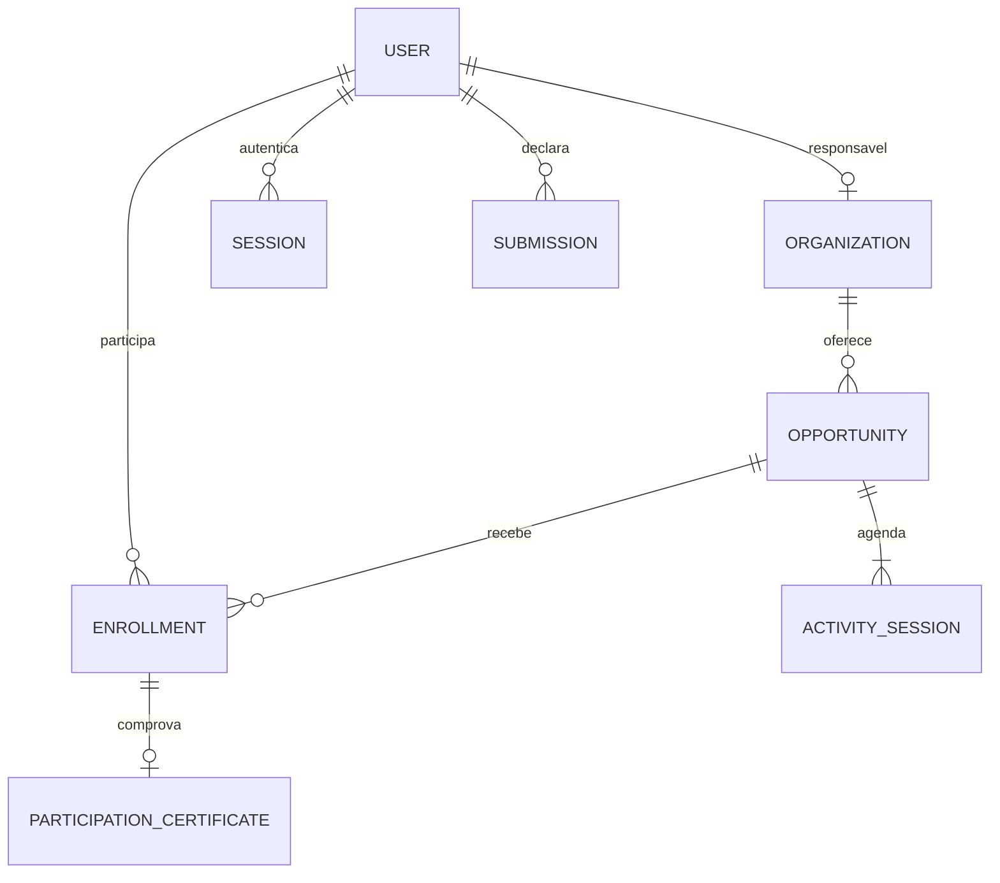

# Arquitetura do back-end

O pacote `backend/` implementa a API REST com NestJS, TypeORM e SQLite. O front-end continua
na raiz do workspace pnpm e se comunica com a API pelos Route Handlers do Next. A identidade
visual e a organização Feature-Based foram preservadas.

## Camadas e contratos

Controllers traduzem parâmetros HTTP e delegam a Services. DTOs com class-validator e
class-transformer validam a entrada; os Services implementam regras e usam os repositories
TypeORM para persistência. Não há acesso ao banco nos Controllers. Schemas Zod validam o
ambiente, as fixtures de seed e as respostas recebidas nas bordas do Next e do cliente.

As entidades usam `EntitySchema<T>` com interfaces explícitas. Isso mantém tipos estritos sem
assertions de inicialização, `any` ou desativação de verificações. O pacote Nest possui configuração
TypeScript própria com decorators/metadados; o Next não compila seus fontes. Imports `@/*`
são resolvidos no build do servidor por `tsc-alias`, sem loader adicional em produção.

A composição inclui os módulos Auth, Opportunities, Organizations, Certificates, Dashboard e
Health. A configuração validada é um provider global tipado. Os Guards JWT e de papéis são
aplicados globalmente: uma rota nova nasce privada, salvo declaração explícita de acesso público
ou opcional.

## Modelo persistente



Há oito entidades. E-mails são únicos sem distinção entre maiúsculas e minúsculas. A combinação
usuário/oportunidade é única, assim como o certificado por inscrição. Encontros têm identidade
própria, data/horários locais e vínculo com a oportunidade. A organização da gestão é a mesma
do catálogo, sem cópia paralela de atividades reais.

Submissões externas armazenam metadados e BLOB SQLite na mesma transação. O documento é omitido
das listagens e só é selecionado para download autorizado. O hash de senha também possui
`select: false`. Chaves estrangeiras e checks protegem categorias, papéis, formatos, status,
horas, tamanho do arquivo e vínculos.

Migrations versionadas criam o schema e triggers de capacidade e presença. Não se usa
`synchronize`. A conexão ativa WAL; um serviço serializa transações de escrita porque o driver
usa uma conexão SQLite por processo. A capacidade também é verificada no banco, de modo que
outro processo não consiga inserir acima das vagas somente por contornar o Service.

Excluir oportunidade com inscrições é conflito, e o banco usa RESTRICT para preservar vínculos.
Encontros de oportunidade sem inscrições são removidos com CASCADE. Não há exclusão pública de
usuários ou organizações porque o produto existente não possui esse fluxo.

## Regras principais

- Cadastro público cria voluntário; organizações são provisionadas pelo seed demonstrativo.
- As contagens de inscritos vêm dos vínculos, sem somar números fictícios do catálogo antigo.
- Inscrição usa a identidade autenticada e recusa duplicidade, lotação ou atividade encerrada.
- Cancelamento remove somente o vínculo da conta e libera a vaga; após emissão, é conflito.
- Organização só altera suas atividades e participantes pertencentes à atividade selecionada.
- Emissão exige pelo menos um presente. Certificados e encerramento são gravados juntos;
  uma segunda emissão é recusada. Não há serviço de e-mail.
- Horas homologadas são calculadas dos certificados de participação. Comprovantes externos
  permanecem em análise e não concedem horas automaticamente.
- Repetir seed preserva senhas, edições, presenças e emissões. Um conflito de papel reverte
  a transação inteira e não promove uma conta existente.

## Infraestrutura HTTP

`ValidationPipe` transforma DTOs, remove a possibilidade de campos arbitrários e rejeita campos
extras, sem incluir valores/objetos nas mensagens. O interceptor responde `{ data: ... }` e
preserva status, `204` e arquivos binários. O filtro padroniza erros com `statusCode`, `error`,
`message` e `details` de validação; falhas inesperadas não expõem SQL ou stack. Violações de
constraints/ocupação do SQLite são apresentadas como conflito.

Logs incluem método, caminho sem query, status e duração. Corpo, cabeçalhos, cookies, tokens,
hashes e exceções com valores submetidos não são registrados. Caminhos são limitados e têm
caracteres de controle removidos. Respostas da API não são armazenadas em cache.

CORS permite origens HTTP(S) exatas, sem curinga ou credenciais de navegador. O Next concentra
as operações com cookie e as validações de origem. O Nest aceita Bearer diretamente para clientes
de API. Indisponibilidade e contrato inválido são erros explícitos; não existe fallback para
JSON, fixtures ou IndexedDB.

## Banco e testes

As instruções completas ficam no README. Com a configuração local preparada:

```bash
pnpm backend:migrate
pnpm backend:seed
pnpm backend:dev
```

`backend:migrate` e `backend:seed` não precisam de JWT para operar o banco; iniciar HTTP exige
`JWT_SECRET`. O seed exige `SEED_PASSWORD` explícita. O comando de desenvolvimento compila antes
de iniciar e precisa ser reiniciado após edições. Para produção, compile e execute
`backend:build` e `backend:start`.

`backend:test` usa HTTP real e SQLite temporário. A suíte cobre configuração, logs, envelopes,
DTOs, CORS, Guards, isolamento, concorrência de vagas, arquivos, seed, migrations e reabertura do
banco. `pnpm test` cobre o adaptador Next com um processo Nest real. Playwright testa o build de
produção com os dois processos e banco temporário. Os scripts encerram seus processos e removem
apenas os diretórios temporários que criaram. O CI inclui os três níveis de validação.

As versões foram verificadas pelos peer dependencies: NestJS 12, `@nestjs/typeorm` 12, TypeORM
0.3.31 e better-sqlite3 12. O major 13 do driver não pertence à faixa do ORM selecionado. Os builds
nativos de bcrypt e better-sqlite3 são permitidos explicitamente no workspace; lockfile é versionado.
A validação local usa Node.js 24.21.0 e pnpm 12.8.1.

Referências de implementação: [EntitySchema no TypeORM](https://typeorm.io/docs/entity/separating-entity-definition/),
[integração Nest/TypeORM](https://docs.nestjs.com/techniques/database) e os tipos/implementações
instalados no workspace. O uso de cookies e Route Handlers segue os guias locais do Next 16.3.8.
